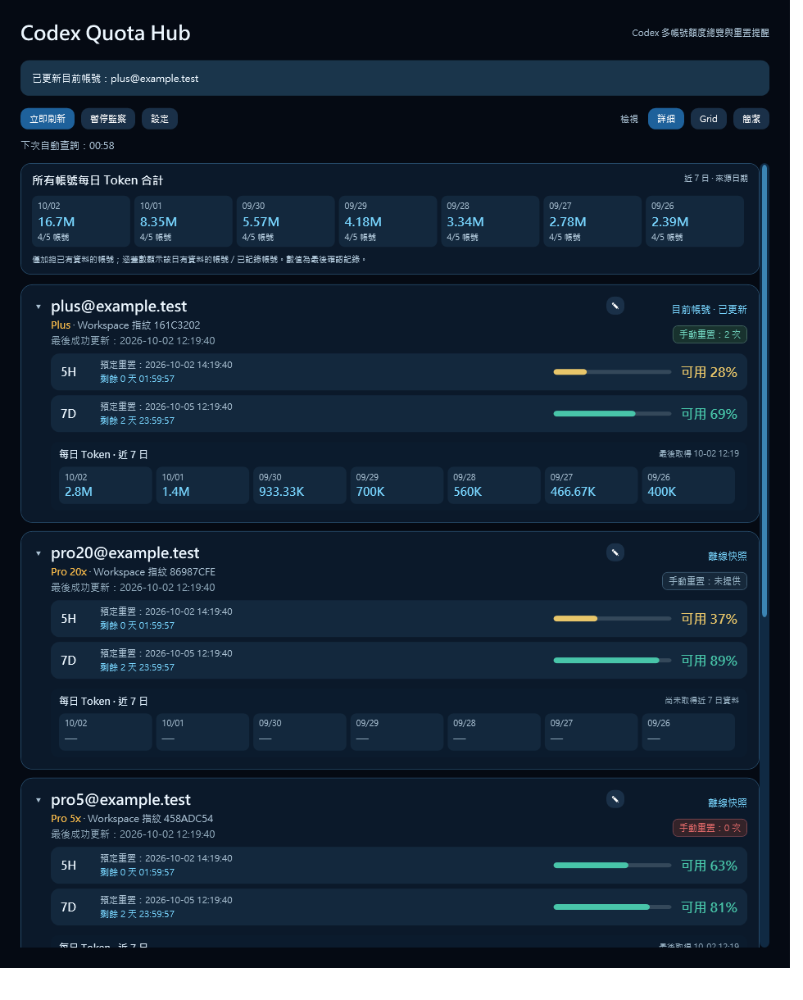
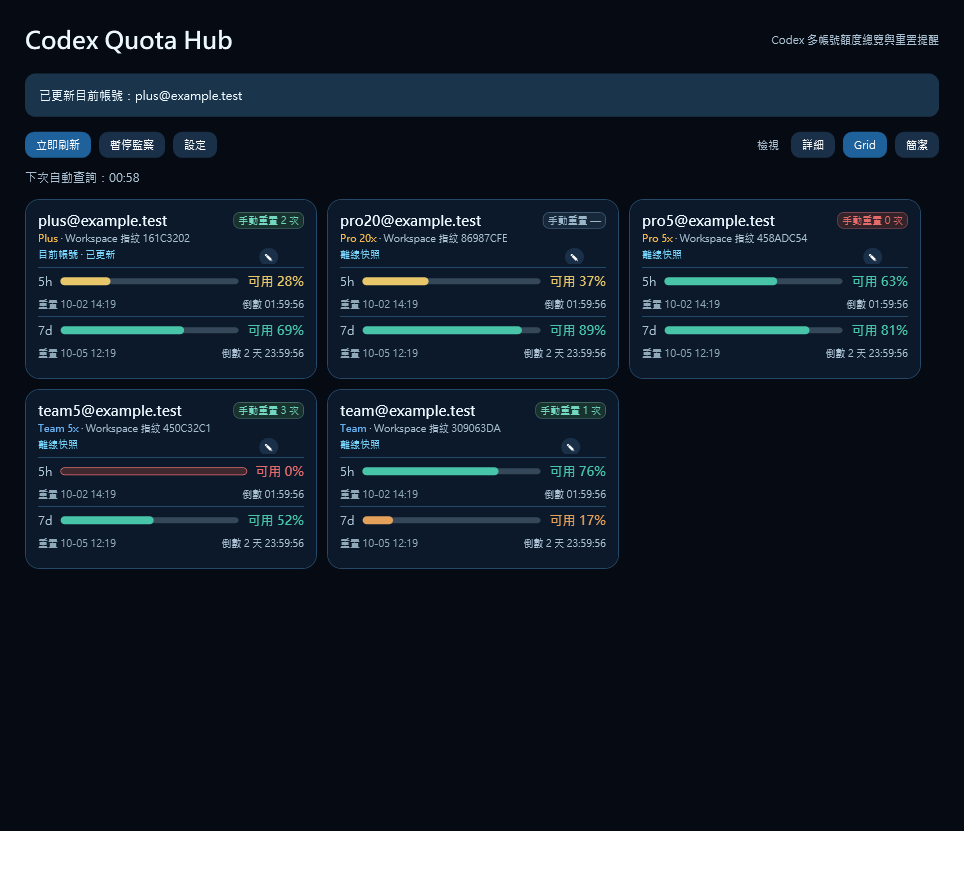
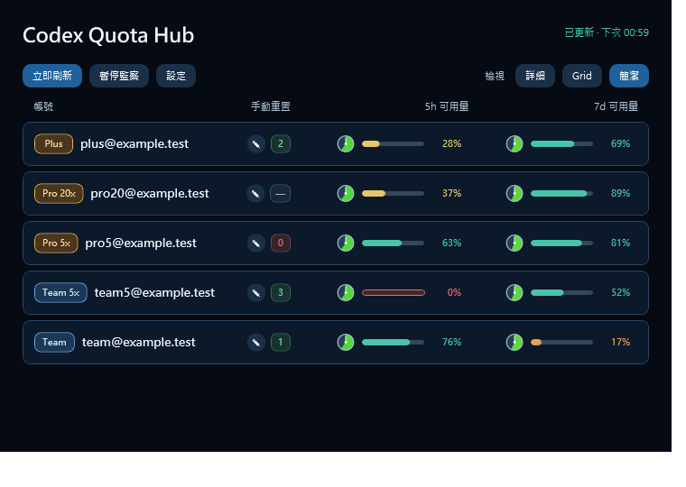

# Codex Quota Hub 1.0

**Codex 多账号额度总览与重置提醒。**

[English](README.md) | [繁體中文](README.zh-TW.md) | **简体中文**

Codex Quota Hub 是 Windows 桌面用量监控工具，让你在独立窗口查看 Codex 账号的可用额度、重置倒计时及每日 Token 使用量。已确认的数据会保存在本地，离线时仍可查看最后一次查询结果。

**1.0 是本项目的第一个公开发布版本。** 提供 Windows x64 桌面程序、命令行工具及完整源代码，采用 MIT 许可证。

## 主要功能

- **额度与倒计时**：显示来源提供的用量窗口，包括 5 小时及 7 天额度、可用百分比、重置时间与倒计时。
- **三种视图**：详细、Grid、简洁，可随时切换；简洁视图以圆形时钟显示重置进度。
- **账号与 Workspace 记录**：分别保存查询成功的账号与工作区，可设置最多 40 个字符的账号别名。
- **每日 Token**：详细视图显示近 7 天的每日数值及已记录账号的每日合计，标明有数据的账号数量。
- **手动重置额度明细**：查看可用次数、来源、说明、状态及到期时间。
- **到期提醒**：支持 Windows 系统托盘及可选的 Telegram 通知。
- **主题与语言**：深色／日间模式；繁体中文、英文、简体中文。
- **本地快照**：启动时加载已保存的数据，默认每 60 秒查询一次；查询失败时保留快照并延长重试间隔。

本工具读取 Codex 当前的登录身份及用量，不提供登录、退出登录、切换账号或兑换手动重置额度的功能。

## 界面预览

以下截图由 1.0 源代码配合虚构账号数据生成，展示的是繁体中文界面。

| 详细视图 | Grid 视图 |
| --- | --- |
|  |  |



[查看手动重置额度明细截图](docs/previews/reset-credit-details.png)

## 下载与启动

### 使用条件

- Windows x64 电脑。
- 已安装 Codex，并在同一 Windows 用户环境登录需要监控的账号。
- 查询最新数据及发送 Telegram 通知时需要网络连接。

Windows 发布包已包含 .NET 运行时，一般用户无需另外安装 .NET SDK。

### 桌面程序

1. 在本项目的 [Releases](https://github.com/kaywkkkkk/codex-quota-hub/releases) 下载 [CodexQuotaHub-1.0-win-x64.zip](https://github.com/kaywkkkkk/codex-quota-hub/releases/download/v1.0/CodexQuotaHub-1.0-win-x64.zip)。
2. 将 ZIP 解压到自己的文件夹，运行 `CodexQuotaHub.exe`。
3. 启动后程序会读取当前账号并保存已确认的数据。首次查询成功前，界面不会显示历史快照。

本地整理的发布包位于 `release-assets/`。ZIP 内还附有使用说明、MIT 许可证及第三方组件声明。

关闭主窗口会最小化到系统托盘并继续监控。要完全停止程序，请在系统托盘菜单选择“退出”。同一 Windows 用户只能打开一个桌面程序实例。

### 基本操作

- “立即刷新”读取当前账号的最新数据。
- “暂停监测”暂停自动查询及 Telegram 到期通知；恢复后继续监控。
- “设置”可更改刷新间隔、主题、语言及 Telegram 配置。
- 详细视图中的账号可逐一折叠；切换视图不会触发重新查询。
- 账号旁的铅笔按钮可编辑别名；留空并保存可移除别名。
- 点击手动重置次数可查看额度明细。数字 0 表示没有可用次数；“—／未提供”表示来源未提供数字。

当你在 Codex 中切换账号或 Workspace，Codex Quota Hub 下次查询只会更新当前账号；其他账号继续显示最后保存的快照。

### Telegram 到期通知

1. 在 Telegram 向 [@BotFather](https://t.me/BotFather) 发送 `/newbot` 创建 Bot，获取 Bot Token。
2. 在 Codex Quota Hub“设置”中填写 Token。在 Telegram 向该 Bot 发送设置界面显示的短代码，再点击“查找聊天”，或手动填写数字聊天 ID。
3. 点击“发送测试”并确认收到消息，勾选“启用 Telegram 到期通知”并保存。

通知包含账号别名、额度窗口及预定重置时间；如果最后一次成功查询提供了可用手动重置次数，也会附上该数字。未设置别名时，程序只附上部分隐藏的邮箱地址，不会自行加入完整邮箱地址或 Workspace ID。别名会按你输入的内容发送。

Bot Token 使用当前 Windows 用户的数据保护机制加密后存入本地数据库。请勿分享 Token 或数据库。点击“清除设置”后保存，可移除 Token 及聊天 ID。已设置 Webhook 的 Bot 无法使用自动查找聊天，可手动输入 ID 或使用专用 Bot。

程序必须保持运行且能够联网才能发送通知。电脑休眠或程序退出期间无法准时发送；恢复后会处理已加入队列而尚未发送的通知。同一重置周期只加入队列一次，网络失败时会重试；若消息已送达但成功记录未能保存，仍可能重复发送。

## 数据与显示方式

- 默认数据库：`%LOCALAPPDATA%\CodexQuotaHub\meter.db`。
- 若新版默认数据库尚不存在，程序会自动沿用已有的 `%LOCALAPPDATA%\CodexMeter\meter.db`，保留账号、别名及设置，无需移动数据库；`--db` 指定的路径仍优先使用。
- 数据包含邮箱地址、Workspace 标识、套餐、用量、重置时间、每日 Token、账号别名及程序设置。请勿将个人数据库上传到 GitHub。
- 重置倒计时按最后确认的时间计算。到期后进度条可能显示 100%，但这只是界面显示，仍需刷新以确认最新可用额度；程序不会自行修改已保存的用量或推算下一轮重置时间。
- 每日 Token 缺少数据时显示“—”，不视为 0。每日合计只包含有数据的账号，来源日期按原值保留。
- 手动重置数据缺少明细时，不会推算其到期时间。
- 查询失败、未登录或查询期间身份发生变化时，已有快照不会被覆盖。

数据查询通过本地 `codex.exe app-server` 进程进行。程序会先查找 Codex 的本地安装目录；如果找不到，可指定路径：

```powershell
.\CodexQuotaHub.exe --codex "C:\path\to\codex.exe"
.\CodexQuotaHub.exe --db "C:\path\to\meter.db"
```

## 命令行工具

下载并解压 [CodexQuotaHub-Cli-1.0-win-x64.zip](https://github.com/kaywkkkkk/codex-quota-hub/releases/download/v1.0/CodexQuotaHub-Cli-1.0-win-x64.zip)，在所在文件夹运行：

```powershell
.\CodexQuotaHub.Cli.exe refresh
.\CodexQuotaHub.Cli.exe list
.\CodexQuotaHub.Cli.exe watch --interval 300
```

| 命令 | 用途 |
| --- | --- |
| `refresh` | 查询当前身份与用量，确认一致后保存快照。 |
| `list` | 读取本地快照并显示倒计时，不连接 App Server。 |
| `watch` | 定期查询；默认每 60 秒一次，按 Ctrl+C 停止。 |
| `help` | 显示参数说明。 |

可用 `--db <路径>` 指定数据库，或在 `refresh`／`watch` 使用 `--codex <路径>` 指定 Codex 可执行文件。`watch` 的 `--interval` 接受 15–3600 秒。命令行工具与桌面程序默认使用同一数据库。

## 从源代码构建

开发环境需要 Windows 及 [.NET 10 SDK](https://learn.microsoft.com/en-us/dotnet/core/install/windows)。在项目根目录运行：

```powershell
dotnet build CodexQuotaHub.slnx -c Release
dotnet run --project src/CodexQuotaHub.Desktop
dotnet run --project src/CodexQuotaHub.Cli -- list
```

运行已有的核心测试：

```powershell
dotnet run --project tests/CodexQuotaHub.Core.Tests -c Release
```

重新生成 Windows x64 发布包：

```powershell
powershell -ExecutionPolicy Bypass -File scripts/publish.ps1
```

脚本会构建包含运行时的单文件桌面及命令行可执行文件，连同说明和许可证打包到 `release-assets/`，并生成 ZIP 的 SHA-256 校验值。程序及 SQLite 所需的原生库会封装在可执行文件内。

`tests/CodexQuotaHub.Desktop.Visual` 提供使用虚构数据验证和截取 WPF 界面的工具。若要重新生成 README 预览图，还需要 Python 及 Pillow：

```powershell
python -m pip install Pillow
python tests/render_view_previews.py
```

## 项目结构

```text
src/                  核心、桌面及命令行源代码
tests/                核心测试及 WPF 界面验证工具
docs/previews/        1.0 界面预览
docs/third-party/     第三方许可证及声明
scripts/publish.ps1   Windows 发布打包脚本
release-assets/       本地发布包（不提交到 Git）
Directory.Build.props 统一版本及作者信息
CodexQuotaHub.slnx    构建解决方案
README.md             英文说明
README.zh-TW.md       繁体中文说明
README.zh-CN.md       简体中文说明
CHANGELOG.md          英文版本记录
LICENSE               MIT 许可证
```

GitHub 源代码及 Release 附件的整理方式见 [发布说明（英文）](docs/RELEASE.md)。1.0 功能清单见 [版本记录（英文）](CHANGELOG.md)。

## 1.0 使用限制

- 只提供 Windows x64 发布包，未包含安装程序、开机自动启动或崩溃后自动重启功能。
- 只会查询当前登录的账号，历史账号的快照不会在后台单独更新。
- 额度、每日 Token 及重置明细以 Codex 返回的数据为准；未提供的字段会显示未知。
- Codex 更新后，App Server 的接口或数据格式变化可能影响查询。
- 在与 Codex 不同的 Windows 用户或隔离环境中运行，可能无法读取当前登录身份。

## 许可证

Copyright (c) 2026 kaywkkkkk。Codex Quota Hub 采用 [MIT License](LICENSE)。Windows 可执行文件中包含的第三方组件保留各自的原有许可证，详见 [第三方声明（英文）](THIRD-PARTY-NOTICES.md)。
